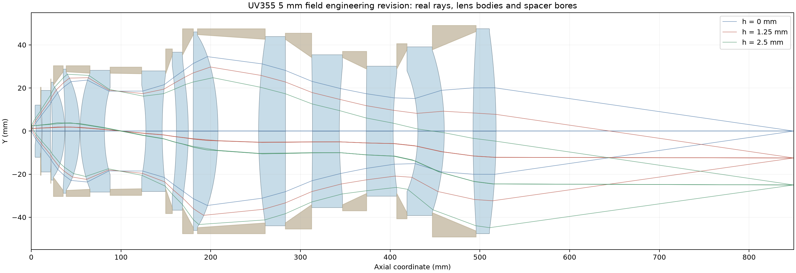

# standalone-optics

用于 Codex 的成像光学设计与独立验证技能。从项目规格出发，建立候选结构、优化实光线像质，并按统一口径复核。适用于物镜、相机镜头、中继与投影、望远成像和变焦等项目的设计规划。具体结构由可表达该模型的求解器计算。

## 通用设计流程

2026-11-13 下一版新增 **MF 工作集与计算预算**：依赖编译、配置/主波长状态隔离、显式保护根、球面采样冗余证明及超预算停止。绿光案例核心工作 MF 从23,030行减至6,375行，含焦面引导的工作 MF 从203,427行减至18,454行；完整验收独立保留。[策略与接口](references/merit-function-budget.md) · [Zemax/MF下载、重现和原生实测](examples/green8-mf-compact/README.md)。

设计前建立[加工与装配边界](references/manufacturing-boundaries.md)。插件可在 CPU/CUDA 候选评分前执行同轴实体检查，对当前已实现的检查应用项目配置。报告区分失败、数据未完成和已通过的名义几何，并保留最薄厚度和最小净距的实际位置及余量。

1. **写清验收口径。** 定义共轭、视场、光谱、NA 或 F 数、探测器、包络和制造约束。把验收项、优化目标和诊断量分开。
2. **建立多个结构起点。** 用一阶成像条件解组功率、间距和光阑位置，再用实光线检查通光、像面和结构可行性。
3. **分级优化。** 低采样筛结构，保留多个结构分支。用多视场、多波长残差精修入围方案，先处理占主导的像差和硬约束。
4. **独立复核与交付。** 加密视场和瞳面，复核最坏工况、实体几何和公差。冻结处方、求解设置及验收结果。

完整方法包括结构搜索、删片和缩短总长、评价函数、CPU/GPU 粗筛、求解器选择和验收模板。UV355 物镜是其中一个应用例子。[通用成像光学设计方法](references/imaging-design-method.md)

## 优化算法总结

[阅读成像光学优化算法总结](references/reusable-optimization-method.md)：多结构与真实材料筛选、有符号OPD范数、波前/场曲/轴向色差联合评价、解析导数、信赖域与二阶修正、CPU/GPU分工，以及复消色差研究的有限实测证据。2026-11-13新增[14片绿光设计过程与Zemax/MF案例](examples/green8-14element/README.md)，原始绿光目标及增强名义实体已通过独立与原生复核；制造放行未完成。文档明确区分公开实现、本地研究验证和待完成的设计验收；现已提供[可执行内核及同预算对照](examples/runtime-upgrade-20261113/README.md)，项目专有适配器与通用模块的覆盖范围分别说明。

## 可执行优化与工程接受链

2026-11-13发布逐片约束和实际通光接受链修复：六个逐片覆盖字段、共享面及空气接口约束现已执行，CPU/CUDA候选入口和普通分析联动全路径光线包络与CA/机械实体检查。名义实体、有限采样通光和完整制造放行分别报告；历史问题见[审查记录](references/manufacturing-audit-20261109.md)。

新增可执行的[局部优化接口](references/local-optimization.md)：解析光线/OPD导数、QR范数模型、缓存信赖域、SLSQP与可选Clarabel直接SOCP、始终保持的硬门、有界非线性投影和自动最坏点交换。[公开光学对照与有界补偿案例](examples/runtime-upgrade-20261113/README.md)提供运行命令、环境及原始结果。真实玻璃选择使用[目录与组合搜索](references/glass-catalogs.md)，厂商完整目录保存在本机私有数据中。

```text
python -m pip install -r requirements-optimize.txt
python examples/runtime-upgrade-20261113/run.py --out output/comparison --repeats 3
```

## 当前计算覆盖

独立内核使用 Python 和 NumPy 计算受支持的同轴顺序折射系统，运行计算无需安装 Zemax。支持有限和无限物距分析，可输出 RMS 波前、光斑、常用几何像差、点阵图、扇形图及 MTF。内置初始结构生成器面向有限共轭三组模型。离轴、反射、自由曲面和多构型等项目可沿用设计流程，由支持相应模型的求解器承担追迹与验收。[已验证的计算范围](references/validated-scope.md)

## 成功案例 UV355 高 NA 物镜

当前 F 版完成了 **5 mm 物方全视场、NA 0.60、13 片、849.99 mm 总长**的名义设计与同处方验证，Zemax 最坏 RMS 波前为 **0.048038 λ**。展示包括光路图、波前与光斑、场曲/像散、点阵与光线扇形图，以及可借鉴的分级求解和工程边界方法。

[查看案例、验收数据与完成状态](examples/uv355-5mm/README.md)



案例已通过名义光学和项目显式实体复核；供应商加工确认、完整公差良率和最终装配/热验证仍待完成。

## 安装

使用有仓库访问权限的 GitHub 账号，将本仓库克隆到 Codex 的技能目录。以下是 PowerShell 命令。若设置了 CODEX_HOME，使用其中的 skills 目录。

```powershell
git clone https://github.com/wufansaber/standalone-optics.git "${HOME}/.codex/skills/standalone-optics"
python -m pip install "numpy>=1.26,<3"
```

需要 Python 3.10 或更新版本。打开新的 Codex 对话后可调用 `$standalone-optics`。也可以在仓库根目录直接运行内置示例。

```powershell
python scripts/standalone_optics.py --demo --out demo.json
```

## 计算常用像差

```powershell
python scripts/standalone_optics.py --model lens.zmx --glass-dir Glasscat --aberrations --mtf --mtf-all-waves --plot-dir plots --out analysis.json
```

`--aberrations` 输出几何像差曲线。`--mtf` 输出像方频率（lp/mm）上的多色 MTF，追加 `--mtf-all-waves` 可同时输出各单色曲线。自动模式在衍射计算触发回退条件时使用低频几何计算，并标记所用方法。`--plot-dir plots` 输出各视场的点阵图和光线扇形图 SVG。各类分析可独立运行。计算受支持的 ZMX 时请提供自己的 AGF 材料目录。也可使用预先导出的中性模型 JSON。仓库包含技能代码、说明和验证摘要。

- [安装与使用](references/install-and-use.md)
- [验证结果与适用范围](references/validated-scope.md)

## 生成初始结构和并行粗筛

```powershell
python scripts/optimize_optics.py seed --demo --workers 4 --dense-top 8 --out seed-report.json --best-model-out best-seed.json
```

按有限共轭的总长、倍率、组功率和间距生成三组初值。支持把已有处方的曲率候选分批并行追迹，再以密采样复核入围结果。可使用 `--backend cuda` 选择 NVIDIA GPU 粗筛。已有多片组可用 `groups` 保留完整组矩阵并搜索组间空气间距，也可配置联动曲率模式搜索组光焦度。[初始结构与多核筛选](references/optimization.md)

## 显微高精度加工与公差约束

新增基于用户本机资料库原页核查的[球面、非球面及反射镜约束总结](references/microscope-manufacturing-constraints.md)和[项目检查登记表](references/microscope-constraint-register.example.json)。涵盖结构厚度/净距、定心与楔角、面形/粗糙度、非球面斜率与检测、反射镜支承与镀后验收，以及系统公差与补偿。数字保留来源和适用范围；未完成项不会变为制造通过。运行时仅执行其已有几何字段，反射与三维装配由兼容后端复核。

## 14片绿光案例与算法策略

[设计过程、下载Zemax与完整MF](examples/green8-14element/README.md) · [受约束搜索策略与数学模型](references/green8-constrained-design-strategy.md)。内容覆盖真实材料替换、解析导数、直接SOCP与QR压缩、工程延拓、非线性修正、真实瞳OTF、最坏点加密和原生保存重载。已授权公开的案例文件与研究求解器运行时分别说明；后续可执行代码升级见上方内核说明，原案例文件字节保持不变。
