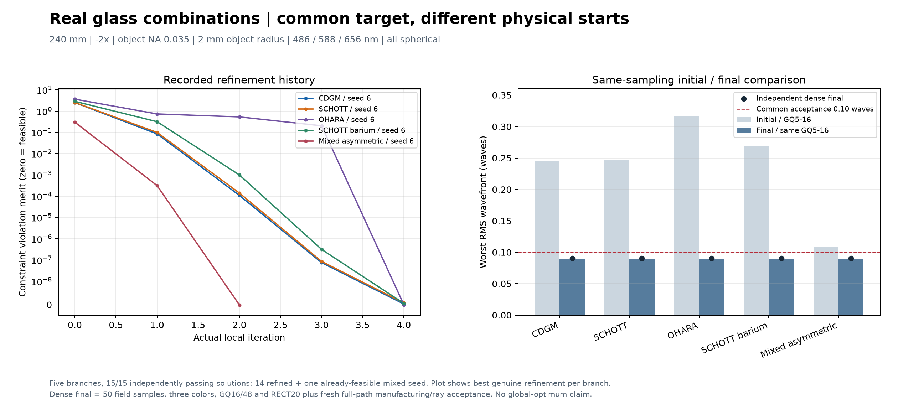

# 真实玻璃组合 × 初始结构 × 连续优化

这个 CPU 示例验证五种真实的 crown/flint/crown 材料组合能达到**同一个预先固定的验收目标**，包括高折射率及跨厂商非对称组合。每个材料分支保留自己的结构、求解记录和加密验收结果。它演示多个不同初始结构收敛到同一验收区间，不声称不同玻璃得到相同处方、唯一最优解或任意种子均能收敛。

本例使用普通球面三单片有限共轭中继。它的验收值属于此演示项目，不复用 UV355 案例的验收表。

## 固定目标

| 项目 | 所有材料分支共同要求 |
|---|---|
| 物面到像面总长 | 固定 240 mm |
| 放大率 | −2×，全光谱近轴误差 ≤0.01 |
| 孔径、视场 | 物方 NA 0.035；物方半视场 2 mm |
| 光谱 | 0.486 / 0.588 / 0.656 µm；等权，0.588 µm 主波长 |
| 面型与片数 | 3 个独立单片、6 个球面；无非球面 |
| RMS 波前 | 每个波长/视场/验收瞳面规则 ≤0.10 λ |
| RMS 光斑 | 每个波长的 RMS 半径 / 实际像方 NA 对应 Airy 半径 ≤1 |
| 映射 | 像高绝对误差 ≤0.02 mm；h≥0.25 mm 的相对 −2× 映射误差 ≤0.5% |
| 实体 | CT=4 mm；径向最薄厚度 ≥1.2 mm；轴上/径向/轮缘空气隙 ≥2 mm |
| 孔径和工艺分配 | 光学半口径 6.5 mm，机械半径 7 mm；CA 至实体余量 ≥0.5 mm；面斜率 ≤0.6 |

上述实体数字是本例明确分配的名义边界，不能据此推断供应商加工能力、公差良率、透过率或实际材料供货状态。

内部精修使用更紧的 0.09 λ、0.95 Airy 比、0.018 mm 像高及 2.05 mm 空气隙目标，以为独立复核留余量；验收上限始终保持表中的同一组数值。

## 真实材料和本地数据

| 分支 | 前 / 中 / 后 |
|---|---|
| CDGM | H-K9L / H-ZF2 / H-K9L |
| SCHOTT | N-BK7 / N-SF5 / N-BK7 |
| OHARA | S-BSL7 / S-TIM2 / S-BSL7 |
| 高折射率 SCHOTT | N-BAK4 / N-SF10 / N-BAK4 |
| 跨厂商非对称 | SCHOTT N-BAK4 / CDGM H-ZF52 / OHARA S-BSL7 |

必须提供由 `standalone_glass_catalog.py` 建立的用户本地 index。程序按明确的 vendor/name 和 `current_only=True` 查找，用对应不可变 AGF 快照的原始色散公式重算三个波长的折射率。三波长全部冻结，连续优化期间禁止改变材料名、目录身份、折射率、波长顺序、权重或主波长。

默认拒绝 NM 标为 obsolete/status=2 或 exclude_substitution=1 的新设计候选。当前目录成员、公式可计算和名义数据一致性均不代表可采购；报告保留材料状态、目录身份、官方发布元数据和快照 SHA256。仓库不附带或复制供应商 AGF 正文。

## 运行

需要 Python、NumPy、SciPy 和用户自己的本地材料索引。在仓库根目录执行：

```powershell
python examples/glass-combination-search/run.py `
  --index C:/my-local-glass-index/glass-index.json `
  --out C:/my-results/glass-combinations-run-001 `
  --seeds-per-branch 3 --iterations 65
```

输出目录必须不存在或为空；程序不覆盖历史搜索。`--seeds-per-branch` 控制每个材料组合实际连续优化的种子数。随机种子固定，CPU 耗时受硬件、BLAS 和系统负载影响。

## 实际工作流

1. `search_seeds` 在固定共轭和总长下解析求解前后组功率，只采样组间距和中组功率，保留不同间距布局。示例先筛选 4096 个薄透镜候选，保留 14 个结构。
2. `realize_seed` 对各材料分支分别使用真实色散表生成有厚度的三单片结构，在主波长恢复同一一阶共轭，再做严格实光线和机械粗筛。每族的种子从自己的实际玻璃重新生成。
3. 每族按真实波前粗评排序，选 3 个起点，使用 `EfficientSolveMixin` 同时调整六个球面曲率和三个镜组位置。缩放参数、带符号的波前/光斑残差、QR 压缩局部模型、缓存导数和信赖域减少无效追迹。先消除约束违反，再接受经精确光线重算的步长。
4. 独立验收从求解器之外重建 50 次场采样（25 个半径、两个方位，轴上重复一次）、全部三波长，以 GQ16/48 和 RECT20 复算像质。通用制造审核在 2049 径向采样与内部极值检查后，再将全部场、波长、内部瞳面、主光线和 128 条精确边瞳连接到完整路径 CA/机械口径检查。局部数值收敛不能代替此验收。

独立验收指与优化采样、目标与接受逻辑分离的加密复核；本例仍使用同一独立追迹内核，未声称这九个演示解另经 Zemax 或第二个追迹内核对照。

## 实测记录

随附 `benchmark-results.json` 保存实际运行的共同目标哈希、每个材料的精确快照身份、每次起点与最终指标、失败原因、壁钟时间和射线运输计数。所测五种材料组合各有 14 个物理种子，各调用求解器 3 次，**15/15 解通过同一验收**：其中 14 次实际修改连续参数，另一次跨厂商种子本来已可行，求解器以零步接受基线。原三个厂商组合的起始最坏波前约 0.223–0.321 λ，超过 0.10 λ 上限；全部最终加密最坏波前范围为 0.08495–0.09094 λ。该次 CPU 实测总耗时64.43秒、累计约708万次射线运输，不代表其它电脑的固定性能。

| 材料分支 | 三个加密验收 WFE（λ） | 三个起点均通过 |
|---|---|---|
| CDGM | 0.0906681 / 0.0901759 / 0.0903684 | 是 |
| SCHOTT | 0.0906100 / 0.0901747 / 0.0903538 | 是 |
| OHARA | 0.0901635 / 0.0901664 / 0.0901538 | 是 |
| 高折射率 SCHOTT | 0.0906893 / 0.0901965 / 0.0909417 | 是 |
| 跨厂商非对称 | 0.0849511 / 0.0906200 / 0.0907726 | 是（首个为已可行基线） |



左图是每族最佳实际精修解的真实约束违反量历史。跨厂商已可行基线另行保留，图中采用实际精修的seed6。右图起/终值使用相同粗采样，黑点另标独立加密验收值；因此没有将不同采样的变化误算成优化收益。

记录中的第一次探索保留了一个有效反例：OHARA 的局部像质已通过，独立制造审核发现约 1.82–1.85 mm 的轴上空气隙未满足 2 mm。修正粗阶段遗漏的中心间隙约束后，沿用原共同目标重新优化通过。这个例子说明密采样和实体接受链须独立于局部评价函数。

## 迁移到其他项目

通用模块是 `scripts/ai_zemax/standalone_glass_search.py`。它提供显式分组允许材料的有界笛卡尔枚举、真实材料全光谱冻结和 `run_combination_search`。项目通过四个回调接入结构求解器：

```python
result = run_combination_search(
    index=index, combinations=allowed_combinations, seeds=initial_structures,
    target=frozen_project_target, output_directory=fresh_directory,
    realize=realize_structure, screen=coarse_real_ray_score,
    optimize=continuous_refinement, validate=independent_acceptance,
    seeds_per_branch=3,
)
```

把实际共轭、视场/孔径、光谱、面型、结构边界和工艺要求放在共同项目目标里；让不同材料共享同一验收，而由各分支重新恢复一阶功率分配和实光线映射。复杂系统可替换结构生成和追迹回调，并保留相同的材料冻结、候选审计和独立接受链。对离轴、反射、自由曲面等超出当前同轴顺序折射内核范围的系统，必须换用能表示该几何的后端。

`SEARCH.json` 保留全部材料分支，`BRANCH.json` 保留所有粗筛种子，`seed-*/RESULT.json` 保留每次实际求解和验收，`CANDIDATE.json` 是对应演示模型。只从验收通过解中选本分支代表；不让一个赢家抹去其他材料路线或失败证据。
