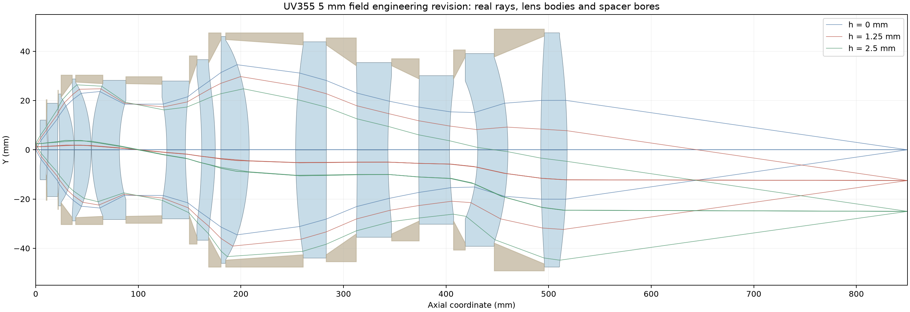
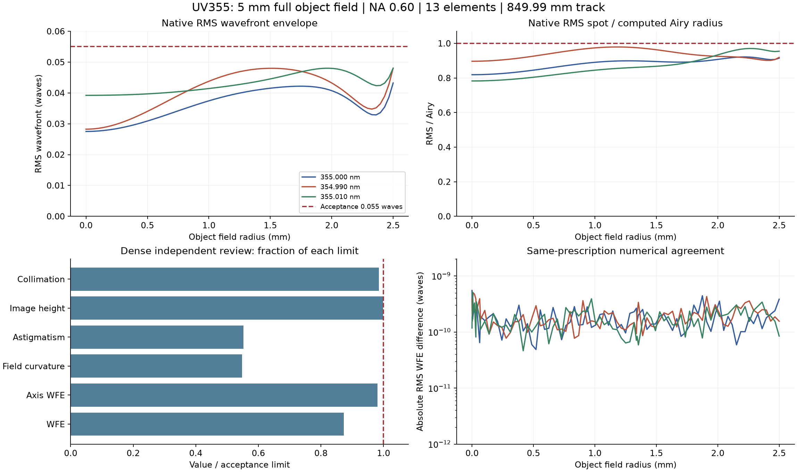
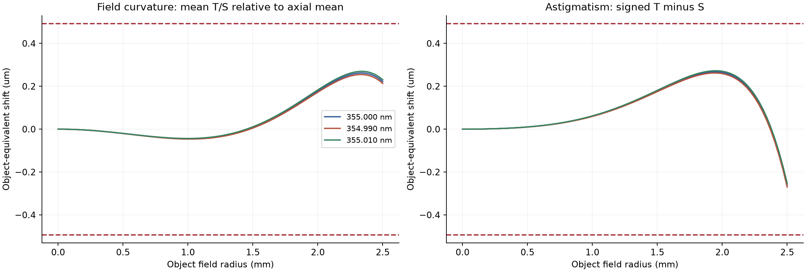
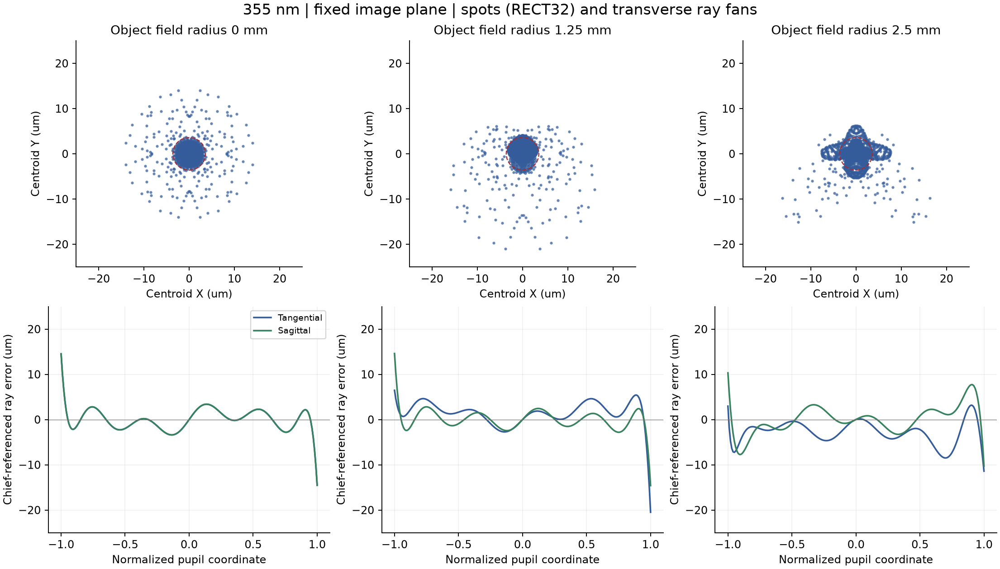
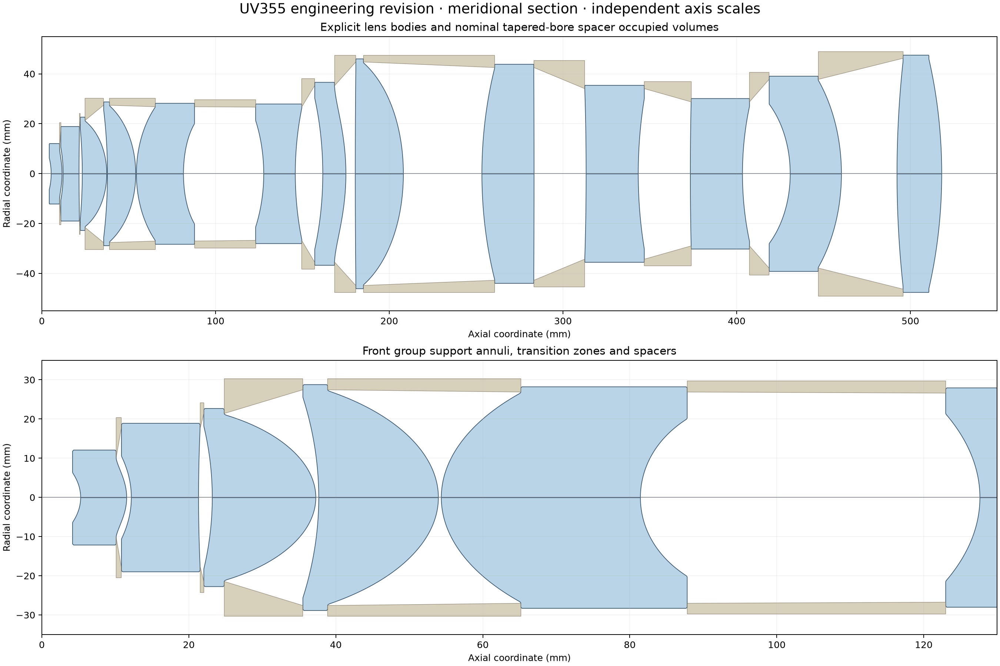

# 成功案例 UV355 高 NA 物镜的 5 mm 视野工程设计

这套案例展示 AI 协同结构调整、CUDA 批量追迹、最坏视场搜索和 Zemax 同处方复核的工作方法。推荐 F 版保持 **5 mm 物方全视场、NA 0.60、13 片和 849.99 mm 总长**，最坏 RMS 波前为 **0.048038 λ**，完成了名义光学、显式镜片实体及隔圈通光复核。

验证日期为 2026-11-08，展示整理日期为 2026-11-09。案例的成功范围是达到既定名义设计指标并保存可追溯证据。供应商加工确认、完整公差良率、镜筒预紧/热验证和实际锯齿挡杆的衍射性能仍有待完成。

蓝色为解析定义的镜片实体，棕色为隔圈包络，光线对应三个物高。横纵坐标按图示分别缩放。这是计算示意图，全部镜片实体位于约前 520 mm 内，最终像面位于 849.99 mm。

## 设计目标与结果

物方全视场直径为 5 mm，图中最大物高是 2.5 mm。名义倍率为 −10×。采用 355.000、354.990、355.010 nm 三个不同波长，保留项目原五通道及权重。镜组片数为前/中/后 5/3/5，使用四个偶次非球面，材料色散来自原项目真实材料目录。

| 指标 | F 版结果 | 验收条件 |
|---|---:|---:|
| Zemax 全场最坏 RMS 波前 | 0.04803799 λ | ≤0.055 λ |
| 独立轴上最坏 RMS 波前 | 0.03922212 λ | ≤0.040 λ |
| 独立最坏 RMS/Airy | 0.979165 | ≤1 |
| 物方场曲 | 0.269903 µm | ≤0.493 µm |
| 物方像散 | 0.272529 µm | ≤0.493 µm |
| 物方单个 T/S 焦面最大偏移 | 0.356987 µm | ≤0.493 µm |
| 像高误差 | 14.976003 µm | 严格小于15 µm |
| 物方主光线最大角 | 0.019970° | ≤0.020° |
| 像方主光线最大角 | 0.079898° | ≤0.080° |
| 前组准直偏离 | 0.985241 mrad | ≤1 mrad |
| 固定尺度正弦映射误差 | 99.714034 µm | ≤100 µm |
| 全部玻璃工作净距 | 4.150 mm | >4 mm |
| 最小实体空气净距 | 0.400 mm | ≥0.300 mm |

MTF 延续项目的曲线判读方式，不作为硬验收项。表中数值对应同一冻结处方，不混用旧版本的 MTF 或像差图。轴上、像高和准直等仍有较紧余量，需要在后续公差工作中同时保护。

上排曲线是在每一波长/物高处，对 GQ20、RECT32、RECT64 和所采样视场方位取最大值。光斑比值中的 Airy 半径由该波长和独立计算的像方 NA 求得。右下角是同处方逐点数值差，不是实物测量不确定度。

## 像差与光斑展示

场曲采用有限孔径几何 RMS 的 T/S 平均焦面，相对同波长轴上平均焦面计算；像散为 T−S。物方等效量按近轴倍率平方换算。曲线使用 GQ32、64 个瞳方位及 81 个视场半径，与项目验收定义一致。

点阵和扇形图为 355 nm、同一固定像面。点阵相对质心，虚线圆为计算的 Airy 半径；扇形图相对主光线。点阵显示全部 RECT32 采样点，扇形图显示至边缘瞳的完整误差范围。

## 可以借鉴的方法

1. **先决定结构分工。** 让组光焦度和间隔承担总长、倍率、前组准直和像方远心的要求，再联合调整曲面，保留多条结构路线。
2. **把实际接口加入优化。** 同时约束有符号 OPD、真实像高、出射方向、正弦映射及实体厚度/间隙。保持材料、光谱、面型许可和用户指标可追溯。
3. **按计算成本分级。** CUDA 批量生成差分响应，低采样产生候选；对少量入围方案做高采样精修。项目局部求解使用有符号残差、QR 压缩、灵敏度条件化和受约束 minimax，并对试探步重新追迹。
4. **从独立复核中补最坏点。** 内部视场和内部瞳区也可能主导评价函数。这个案例把加密复核发现的中间视场排序问题加入目标，而非只保护轴上与边缘。
5. **在同一处方上闭环验证。** 冻结文件哈希后，分别运行独立计算、Zemax 原生操作数和边缘瞳追迹；把不同采样的离轴排序、光斑和光束通行一起检查。
6. **按综合余量选择版本。** 另一路可把最大曲面法线倾角降至约 55°，其最坏波前约 0.05350 λ、晶体外径更大。推荐 F 版以保留更多波前余量。55°/59.8° 是本案例工程分配，不是通用加工标准。

插件已包含独立追迹、常用像差分析及 CPU/CUDA 粗筛。上述局部求解和专用约束由案例项目脚本实现，案例展示不代表通用插件已经提供整套一键复现优化器。

## 显式工程边界

模型分别定义光学有效区、非工作过渡、支承平台及倒角，按完整径向域检查厚度与全部镜片对间隙，并加入 12 个隔圈的占位。106,260 条采样实光线的隔圈检查中，最小径向余量约 0.9453 mm。全径最薄厚度相对项目分档下限的最少名义余量为 80 µm。

这些是项目专用显式实体脚本的复核结果。通用制造模块的两个 P1 接受风险仍见[加工边界审查](../../references/manufacturing-audit-20261109.md)，案例结果不作为该模块已实现完整装配检查的证明。非工作区过渡的刀具可达性、晶体支承应力和最终工厂工艺还需核实。

## 验证覆盖与证据

| 验证 | 覆盖 |
|---|---|
| 独立光学验收 | 689 个物方视场点，三个实际波长，GQ20/RECT32/RECT64，额外密瞳面 |
| Zemax 同处方复核 | 244 个视场点，共 2,196 个视场/波长/采样组合 |
| 波前数值一致性 | 原生与独立最大逐点差约 5.50×10⁻¹⁰ λ |
| 严格轴上排序 | 波前和光斑均通过所列离散采样 |
| Zemax 边缘瞳 | 9,408 条，全部到像面，无追迹错误或渐晕 |
| 显式隔圈通光 | 106,260 条采样实光线，无遮挡 |

以上名义光学验收对应开放通光状态。实际挡杆的有限位置、完整轮廓、衍射、散射及信号/背景抑制另行验收。公差补偿诊断也不能代替同时误差下的全指标良率验证。

- [验证摘要与完成状态](verification-summary.json)
- [公开性能数据](performance-data.json)，包含曲线汇总及点阵/扇形图展示数据。
- [通用设计方法](../../references/imaging-design-method.md)
- [已验证的计算范围](../../references/validated-scope.md)

冻结处方 SHA-256 为 `049e5b39a476154eafe5b75a28b519f2ae7f863195c3af1ecc463c954ed5a055`。公开内容为性能数据、方法和栅格示意图；处方、逐面尺寸、面形系数、材料目录和实体网格保留在项目本地。
