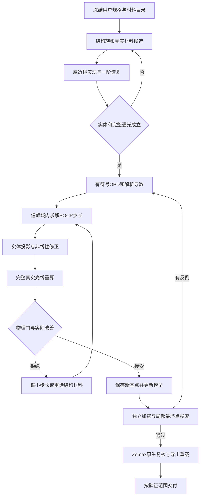

# 从黑盒外部指标到可制造名义结构：优化算法与执行策略

更新：2026-11-13。配套[14 片绿光案例与 Zemax/MF](../examples/green8-14element/README.md)。本文总结实际研究实现；下面的伪代码和策略配置不是现有 CLI 的新增命令。

核心做法是：**外层选择真实材料和结构，内层用有符号波前向量及解析导数做受约束最坏值优化；每次候选都重新追迹，最后用独立加密计算及 Zemax 原生验证决定是否接受。**

## 1. 问题本质与搜索空间

光学设计同时含有离散变量和连续变量。离散变量包括玻璃牌号、片数、胶合方式和分组；连续变量包括曲率、厚度与空气间隔。实体避碰、完整通光、接口和像质要求在这个空间中形成相互耦合的可行域。局部停滞可能来自结构，也可能来自参数尺度、评价口径或错误导数。

本次采用有限预算的多分支搜索，不声称穷尽所有材料组合或证明全局最优。14 片分支的最终连续变量为 24 个曲率与 24 个轴向顶点位置，共 48 维；固定窗口、像面和公开接口要求。每次回写都锁定球面/平面、零圆锥常数与零非球面系数。改变拓扑时重新生成表面、实体与变量映射，不能沿用旧数组索引。



## 2. 先冻结“出口”的定义

每个指标固定单位、波长/构型、物高、瞳面权重、参考面和是否允许调焦。把用户硬条件、工程分配、优化内部缓冲和监测项分别记录。

本案例的原始要求是绿光 8 波长像质；蓝光和 790 nm 只监测像质，但仍必须完整通光。早期探索曾额外使用全 15 波长像质上限和逐场质心横向色差限制。审查发现它们不是原始用户硬要求，随后恢复原范围，保留旧分支作为探索记录。这不是降低既定上限，也不能把不同范围下的评分拼成一条收敛曲线。

原始横向色差门比较指定 6 个绿光波长的实际主光线像高与 536 nm 主光线像高，使用全局像方差值上限；它不等于质心色差、全谱跨度或逐场参考值。深度黑盒对比可以增加诊断，但不会自动改变验收规格。

## 3. 材料搜索：实际波长与主波长响应分别处理

在冻结目录中计算每个候选牌号的真实色散。不得长期把任意连续折射率当成可交付材料；目录可计算也不代表供应、透过率、荧光或环境资格已确认。

本次一轮筛选覆盖 14 个位置与 166 个可替换 OHARA 牌号，去掉各位置原牌号后得到 2310 个单片替换提案。另一个轮次在筛选后的候选中组成 1045 个双片替换提案，对其中 32 个提案求解受约束锥模型。这些是特定轮次的工作量，不是全部组合数，也不是最终通过数量。

以残差向量 b 为例，替换材料的局部响应写为：

$$
\delta b \approx J_q\,\delta q+
J_{n,\lambda}\,\delta n(\lambda)+
J_{n,p}\,\delta n(\lambda_p).
$$

第二项影响被测波长实光线；第三项影响由主波长决定的参考球及相关量。只计算被测波长的折射率响应会漏掉参考变化。本次材料切线包含 48 个几何列、14 个实际波长折射率列及 14 个主波长折射率列，共 76 列。

先用阻尼 SVD 估计可由几何补偿的部分，再排名剩余最坏波前；保留不同位置和作用的提案，避免榜单被同一位置占满。排名只给搜索优先级。入围提案必须换入真实 n(λ)，恢复完整实体和一阶条件，重新进行全 NA 实光线评价及连续精修。最终保留了两个位置的真实材料替换。

## 4. 一阶恢复与厚透镜实现

在相同参考面、坐标和光线向量定义下比较组矩阵，恢复共轭、组焦距、准直和端口关系。用有限厚度、实际玻璃和实体间隔实现之后，重新计算矩阵和高 NA 实光线。

近轴恢复只负责把候选送入有希望的区域。它不能证明波前、焦面、边缘通光或完整径向厚度成立。固定像面波前、实际主光线角、畸变和横向色差在完整系统上共同保护，物镜与 tube 允许通过真实光学耦合分担校正。

## 5. 波前向量、参考变化与解析导数

对工况 i，使用规定参考下、带符号的 OPD 残差构造：

$$
b_i=\frac{\sqrt{w}\,\mathrm{OPD}_{i,\mathrm{res}}}
{\lambda_i L_i},\qquad
W_i/L_i=\|b_i\|_2.
$$

其中权重归一化，OPD 与 λ 使用一致长度单位，Lᵢ 为该工况的波前上限（单位 λ）。参考约定及活塞/倾斜投影随参数的变化也进入导数；未扣除离焦、未移动验收像面。当前项目参考采用主波长近轴附近的实际主光线构造，已做同处方原生对照；这不保证任意几何或任意软件版本自动等价。

局部模型保留整个向量：

$$
\widehat W_i(d)/L_i=\|b_i+J_i d\|_2.
$$

相比只线性化 RMS 标量，它保留了残差抵消方向和范数曲率。解析导数沿球面交点、折射、光程、参考球、倾斜拟合、矩阵和焦位传播。材料、移动 OTF 节点等额外导数都要分别验证。

导数验证采用同点值对照及独立方向差分，并记录步长、失败分支与适用模型；不能用优化器自身的低残差证明导数正确。病例中的误差摘要见 [evidence.json](../examples/green8-14element/evidence.json)。

## 6. 直接 SOCP 与 QR 压缩

用尺度化坐标定义信赖盒 ℓ ≤ d ≤ u。各约束统一为 g(q) ≥ 0，并按物理尺度归一化。内层提案的主要形式为：

$$
\min_{d,t,\nu}\;t+\mu\nu+\frac{\eta}{2}\|d\|_2^2
$$

$$
\|b_i+J_i d\|_2\le t,\quad
g_j+G_jd\ge-\nu,\quad
h_k+H_kd\ge0,\quad t,\nu\ge0.
$$

g 表示当前允许修复的阶段性能或新增工程分配；h 表示始终保护的物理及已锁定约束。共享违反量 ν 只是子问题的修复工具，不能抵消最终某一硬指标的超限。本次直接锥子问题使用 Clarabel；名义可行性投影及有限次非线性修正使用 SLSQP。

对增广矩阵 [bᵢ Jᵢ] 做 QR，令其上三角因子为 Rᵢ：

$$
\|b_i+J_i d\|_2=
\left\|R_i\begin{bmatrix}1\\d\end{bmatrix}\right\|_2.
$$

这压缩的是仿射向量的表示，不是只保留若干主成分。本次实现检查零步范数一致性；迁移或改写时还应核对多个非零方向。

大量线性行可用整个信赖盒上的下界筛选：

$$
\underline g_j=g_j+\sum_k\min(G_{jk}\ell_k,G_{jk}u_k).
$$

只有在盒内不会成为限制的线性行才暂时不进入子问题；接收候选仍重算完整非线性约束。活跃行数减少不等于物理验收项减少。

## 7. 工程延拓、投影与真实步接受

为了从较薄结构到增强结构，曾以 α∈[0,1] 对新增厚度/净距分配做延拓：

$$
f(\alpha)=f_{\mathrm{base}}+
\alpha(f_{\mathrm{engineering}}-f_{\mathrm{base}}).
$$

原始物理底线全过程保持；α<1 的点只能作为中间候选。最终两段绿光收尾都在 α=1，必须满足完整增强分配。达到一个阶段的名义可行性后，后续步继续保护其原始非负约束。另有小的求解缓冲，与制造预算分开记录。

每次提案按以下规则执行：

1. 在原信赖盒内，必要时先投影到完整实体可行域。
2. 真实追迹；对小幅非线性偏离做有限次校正，每次校正后重新追迹。
3. 用校正后的总步长重算局部预测；不把投影前的步长当作实际步长。
4. 原始实体、完整通光、正向传播及锁定约束通过后，才检查实际评分下降与预测一致性。
5. 接受后保存完整新基点并重新建立模型；拒绝只缩小信赖域时可复用同基点模型。改变规格、材料、采样、拓扑或参数顺序时缓存失效。

阶段评分包含最坏归一化波前、最大违反量罚项和很小的平均平方项。实际与预测通常用同一评分比较。若投影修正后保持精确可行，应使用记录过的可行域内评分；对非正预测下降的实际改善分支单列记录，缩小后续步长，不伪造正常的正下降比率。

SLSQP 或 Clarabel 的状态仅表示子问题求解状态。即使返回 `Solved`，也仍需真实约束检查；`AlmostSolved` 也必须经过同样的真实接受链。

## 8. 焦面必须按规定统计量计算

在均匀像方空气中，以光线像面坐标 p、斜率 s=(dₓ/d_z,dᵧ/d_z) 和归一化瞳权重，去除各自质心：

$$
\Delta z_{2D}=-\frac{\sum w\,\Delta p\cdot\Delta s}
{\sum w\,\|\Delta s\|^2}.
$$

T、S 焦移分别由指定方向的协方差/方差计算。本案例轴向色差使用二维几何 RMS 焦面；595 nm 场曲使用 T/S 焦移的算术平均相对同波长轴上值。它们不是可互换的统计量，也不由其他同名原生操作数直接替代。

本例物像方均为空气，物方等效焦移为 Δz/m(λ)²，导数包括倍率变化。其他介质应使用对应的纵向倍率。工作阶段用少量实际色散节点降低成本；正式验收使用 570–620 nm 每 1 nm 共 51 波长。波前始终在固定像面另算，不能用几何最佳焦面上的波前代替它。

## 9. MTF 为复 OTF 的多色组合

收尾加入三个物高、T/S 两方向、100 lp/mm 的绿光多色 MTF 对比目标。计算先在相同主波长参考下，对真实瞳重叠域积分得到各波长复 OTF，再等权平均复 OTF，最后取模；不先平均各单色 MTF 的模值。

工作 F 数、重叠域移动、求积节点及权重的变化都进入导数。用当前几何的实际边缘光线求工作 F 数，不用固定近轴常数代替。任何重叠域光线无效时整次评价失败；通光边界在独立物理约束中逐路径检查，不能靠截去瞳面改善 MTF。

本次工作积分为 10×10 Gauss–Legendre 重叠求积，另外用 20×20 与原生稀疏 Grid=0 检查；没有运行 FFT。六项 MTF 是额外达到的参考改善，不取代原始绿光波前和工程硬条件。

## 10. 最坏点与完整实体的接受链

工作采样负责搜索；独立检查负责寻找反例。视场加密后对局部峰值做一维搜索，关键通光条件再搜索视场与瞳坐标。发现新峰值时加入工作集，重建模型。最终报告仍明确它是有限采样与数值极值检查，不是连续域形式证明。

球面实体检查使用 t(r)=z_b−z_a+sag_b(r)−sag_a(r)，覆盖完整声明机械径向域、内部/分段极值、所有有序实体对及独立外缘。CA、光学球面终止半径、平肩和实体半径分别保存；不能缩小机械域来规避交叠。本例临界体检查用 80 位数值复核，但高精度算术不代替几何模型完整性或公差预算。

最终状态至少分为：工作集可行、独立名义光学通过、名义实体通过、原生同处方与文件重载通过、制造放行。前四项通过不自动使第五项通过。

## 11. 算力与停止策略

本次按用户指定使用逻辑 CPU 0–17，18–19 留给界面；worker 内 BLAS 线程设为 1，避免进程与线程嵌套过量。波长/工况的纯数值计算可并行；原生验证保持最大并发 1，顺序管理所创建的应用实例。这里没有覆盖全流程的 CPU/GPU 同预算加速对照。

停止或换路线前检查：当前主导的是像差、材料色散、实体边界、尺度病态、参考/导数错误，还是错误扩大的规格。结构修改、材料修改与连续精修分别限额并保存失败原因。没有证明某一拓扑无解时，不把若干次失败当成无解证明。

本案例达到原始光学与增强名义实体目标后冻结同一处方，完成独立、原生、MF 算术、保存重载和文件校验。公差筛查仍发现敏感项，交付状态据实保留；后续量产任务需要实际补偿器、装调基准、同时误差与供应商公差模型。

## 12. 可迁移的策略约定

跨项目可复用的是分层搜索、向量局部模型、完整接受链和证据身份；本案例的波段、限值、片数和工程分配均需重新确定。配套 [strategy.example.json](../examples/green8-14element/strategy.example.json) 是策略记录格式示例，不是 `manufacturing_policy` 或现有 CLI 可直接接收的配置。

```python
freeze_user_scope_and_catalog()
for branch in ranked_real_material_and_topology_candidates():
    q = realize_thick_model_and_restore_imaging(branch)
    for stage in engineering_continuation_if_needed():
        while within_budget():
            base = trace_all_requested_conditions(q)
            local = signed_opd_focus_otf_and_geometry_model(base)
            trial = bounded_project_and_correct(solve_socp(local))
            actual = retrace_all_requested_conditions(trial)
            if physical_and_locked_gates_pass(actual) and accepted_actual_change(actual):
                q = save_new_base(trial, actual)
            else:
                shrink_trust_or_change_branch()
        add_counterexamples_and_restart_if_needed(q)
    report = independent_dense_and_native_verify(q)
    if report.original_optical_and_nominal_geometry_passed:
        save_reload_and_hash_native_delivery(q, report)
        report_manufacturing_status_separately(report)
```

该流程已在配套研究案例执行；完整研究适配器没有随本文自动安装到公开 CLI。公开案例可在有许可的 Zemax 中复核，公开独立内核的能力仍以[验证范围](validated-scope.md)和当前实现限制为准。
